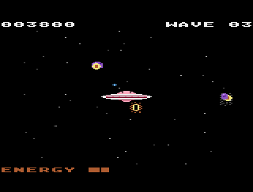

# Cosmic Arc II (Atari 7800)

The sequel to [Cosmic Arc for the RP6502](https://github.com/jasonfrowe/RP6502-Cosmic-Arc),
for the Atari 7800 with the AstroCart (MathUnit + second POKEY).

Defend the Ark in deep space, abduct creatures from doomed planets, and now
navigate a 64-sector galaxy of warps, starports and pirates, trading
Fuel Ore, Organics and Equipment for upgrades, to fill the Ark's manifest
before the star Alpha Ro collapses.

**Status:** M1 (deep-space slice) done: defend the Ark against asteroid waves
with the 8-way laser. Button 2 on the title runs the hardware check.



- [Design document](docs/DESIGN.md)
- [Roadmap](docs/ROADMAP.md)
- [Engine notes](docs/ENGINE.md): build, cart layout, RAM, pitfalls

## Building

Needs `wasmtime` (for the vendored 7800basic) and Python 3.

```
tools/build.sh     # -> build/cosmicarc.a78
tools/play.sh      # run it in the a7800 fork (SaveKey in port 2)
```

Controls: joystick aims, button 1 fires, button 2 (on the title) opens the
hardware check.

## Features (planned)

- **Sector map**: a TradeWars-style galaxy of one-way and two-way warps, port
  classes (`BSB`, `SBS`...), fog of war, fuel and a stardate clock
- **Hybrid deep-space combat**: 8-way point defense from the Ark, or launch
  a fighter and fly it while the Ark's auto-turret covers you
- **Planetary extraction**: the classic shuttle and tractor beam, on
  horizontally scrolling planets that wrap around
- **Starports**: commodities, creature bounties, a shipyard of upgrades
- Dual-POKEY music, AstroCart MathUnit, SuperGame banking, SaveKey save/continue

## Hardware

- Atari 7800 + AstroCart (MathUnit at $0420-$043F, POKEYs at $0440 and $0450)
- Two-button joystick (required)
- SaveKey or AtariVox for saved games

## Related projects

- [RP6502-Cosmic-Arc](https://github.com/jasonfrowe/RP6502-Cosmic-Arc): the first game
- [AtariGammaForce](https://github.com/jasonfrowe/AtariGammaForce): banking, scrolling, POKEY music
- [Super_Mega_Pinball_7800](https://github.com/jasonfrowe/Super_Mega_Pinball_7800): dual POKEY, MathUnit
- [Spacewar_7800](https://github.com/jasonfrowe/Spacewar_7800): MathUnit flight model and AI
- [js7800_astrocart](https://github.com/jasonfrowe/js7800_astrocart): browser emulator

## License

GPL-3.0, as for the other projects in the series.
